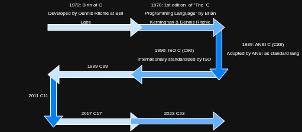

# Basic of C

## Timeline of C language

## Characterstics of C language

- It is middle level language: Means it has simplicity of high level language as well as power of low level language.
- C consist 32 keywords
